<h1 align="center">hypr-shell</h1>

<p align="center">
  a whole desktop for <b>hyprland</b>, written in <b>quickshell</b>.<br>
  one frame around the screen, every menu grows out of it, and the whole system repaints itself from the wallpaper.
</p>

<p align="center">
  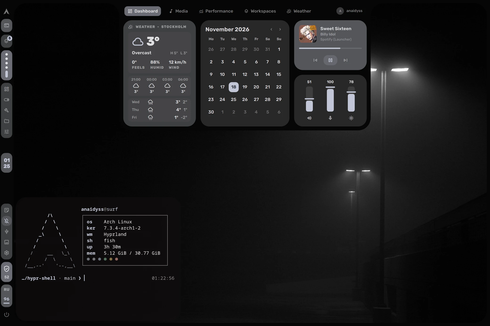
</p>

<p align="center">
  
  
  
  
</p>

## the idea

hyprland only composites. everything you see is the shell: the frame, the strip on the left, the dashboard, the lock
screen, notifications, OSD, the launcher, screenshots, even the cursor. one set of design tokens paints all of it, and
the same tokens paint kitty, GTK, Qt, fish, starship, Firefox, Telegram, Spotify, Obsidian, VSCodium and btop.

menus are not windows. each one is a **branch** of the frame: a shape that grows out of the edge with concave fillets,
drawn as one continuous outline. one opens at a time, on hover or click, and folds back when the pointer leaves.

## what's inside

**the frame and the rail**
- frame around the whole screen, the desktop sits in a rounded cutout (superellipse corners, like the windows)
- rail on the left: pinned and running apps, workspaces, clock, status, five menu categories that unfold on hover
- `Super+M` keeps a branch open on every side at once
- two looks: **glass** (blur, depth) and **solid** (flat tonal layers, à la material you), picked per wallpaper automatically

**dashboard** (`Super+grave`, or hover the top edge)
- calendar, weather (four keyless sources), sliders, media
- **media**: synced lyrics from LRCLIB with karaoke fill and a spring scroll, a 10-band PipeWire equalizer drawn as one
  curve you drag, a live spectrum from cava
- performance: cpu, ram, gpu, disks, network sparklines
- workspaces with live window thumbnails, drag windows between them

**drives** (the rail lights up when a stick is plugged in)
- browse, mount, rename, format, eject
- ISO library: detects the distro and version, shows a badge when a newer release is out, downloads from mirrors with
  resume and checksum check
- write images to a stick with verification, Windows installers in file mode, Ventoy install and update
- full-disk backup to `.img.zst`, speed test, **fake-capacity check** (finds sticks that lie about their size),
  secure erase, camera card import

**everything else**
- lock screen on `WlSessionLock` with PAM, weather, media and missed notifications, hyprlock as a fallback if the shell dies
- launcher + calculator + clipboard + notes in one bottom branch (`Super+D`, `Super+/`, `Super+V`, `Super+Alt+N`)
- screenshot overlay: region to clipboard (`Super+Shift+S`) or an editor with arrows, blur, numbered marks (`Super+Shift+D`)
- mini terminal that lives inside a branch, quick terminal (`Super+T`)
- notification center, do not disturb, toasts that grow out of the frame
- control center: Wi-Fi (including 802.1X campus networks), Bluetooth, sound, battery, VPN
- night light with a 10-minute sunset fade, timer and pomodoro, game mode, color picker, emoji
- wallpaper search, drag a wallpaper from settings onto the desktop and it spreads from the cursor
- touchpad edges for volume and brightness, three-finger swipes open branches
- OLED care: pixel drift, idle dimming

**the palette**
- material you from the wallpaper (matugen), 22 roles, light and dark, presets (catppuccin, tokyo night, nord)
- solid mode tints the frame from the wallpaper itself, glass mode takes its darkest tone
- the cursor is Bibata recolored to the accent on every wallpaper change

## a closer look

<p align="center">
  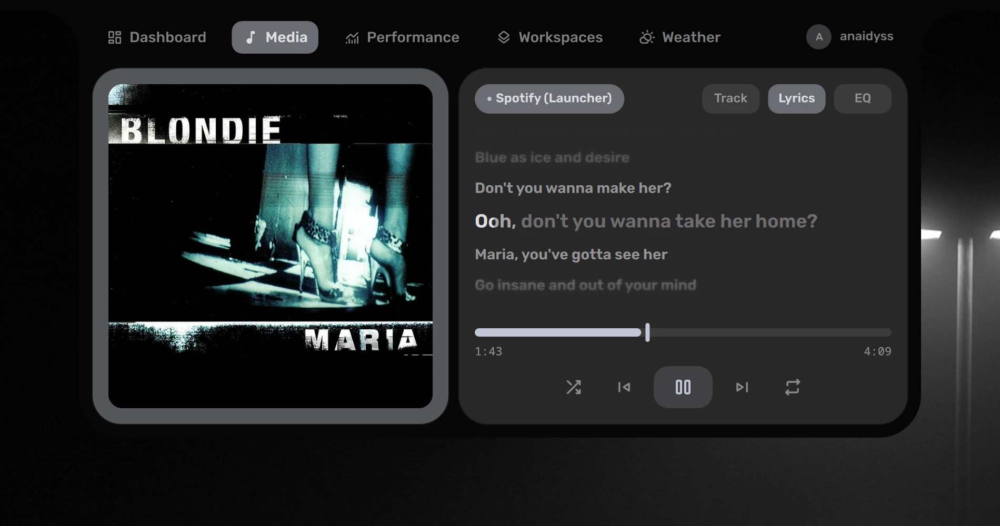
</p>
<p align="center">
  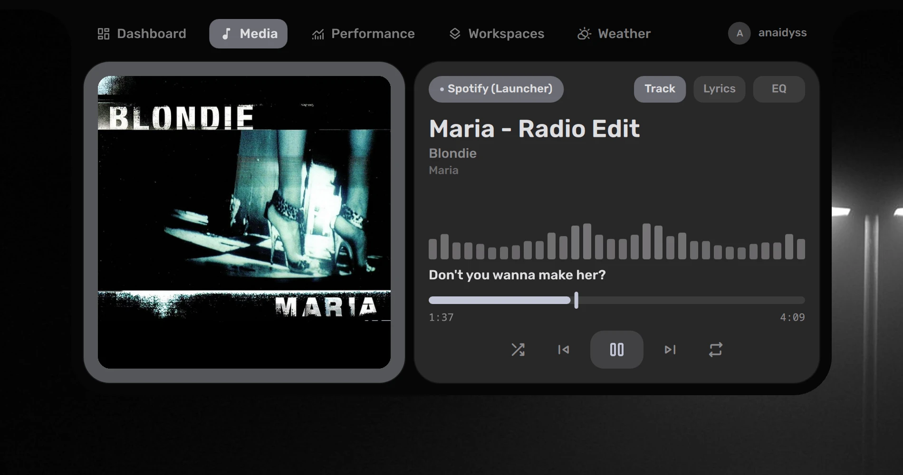
  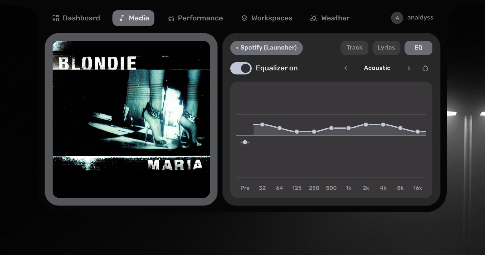
</p>
<p align="center">
  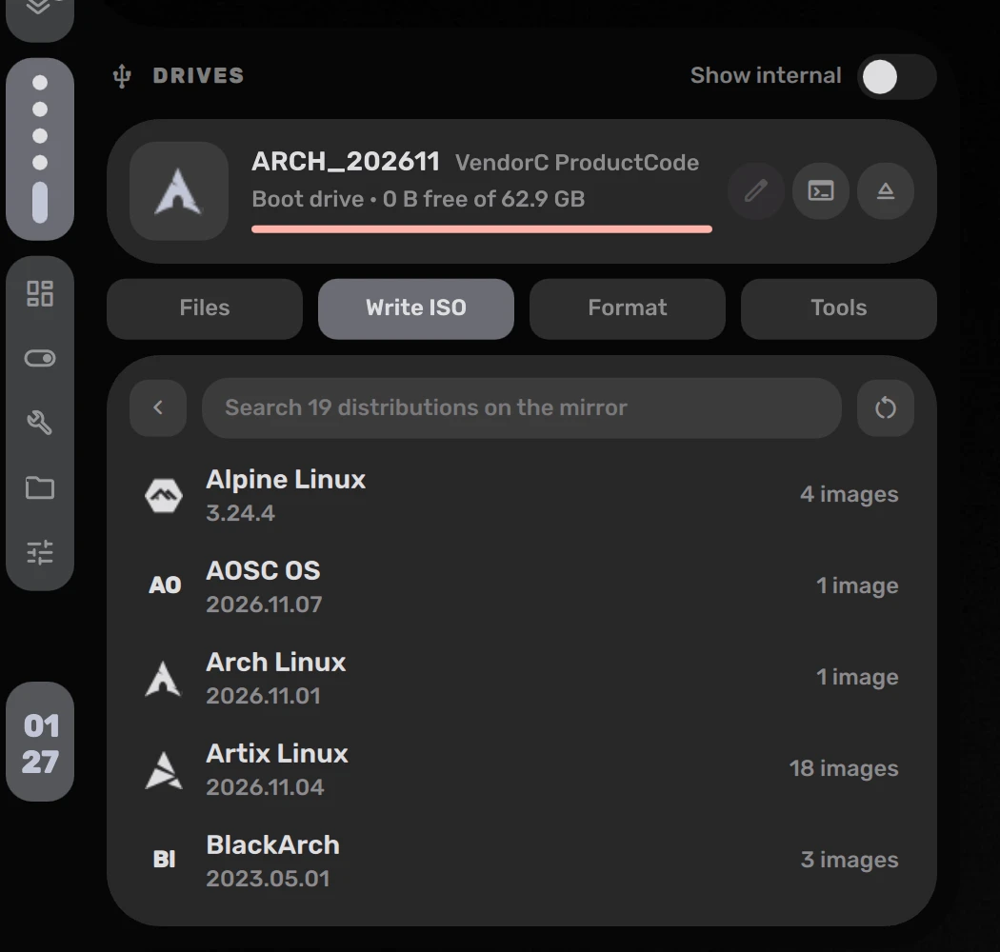
  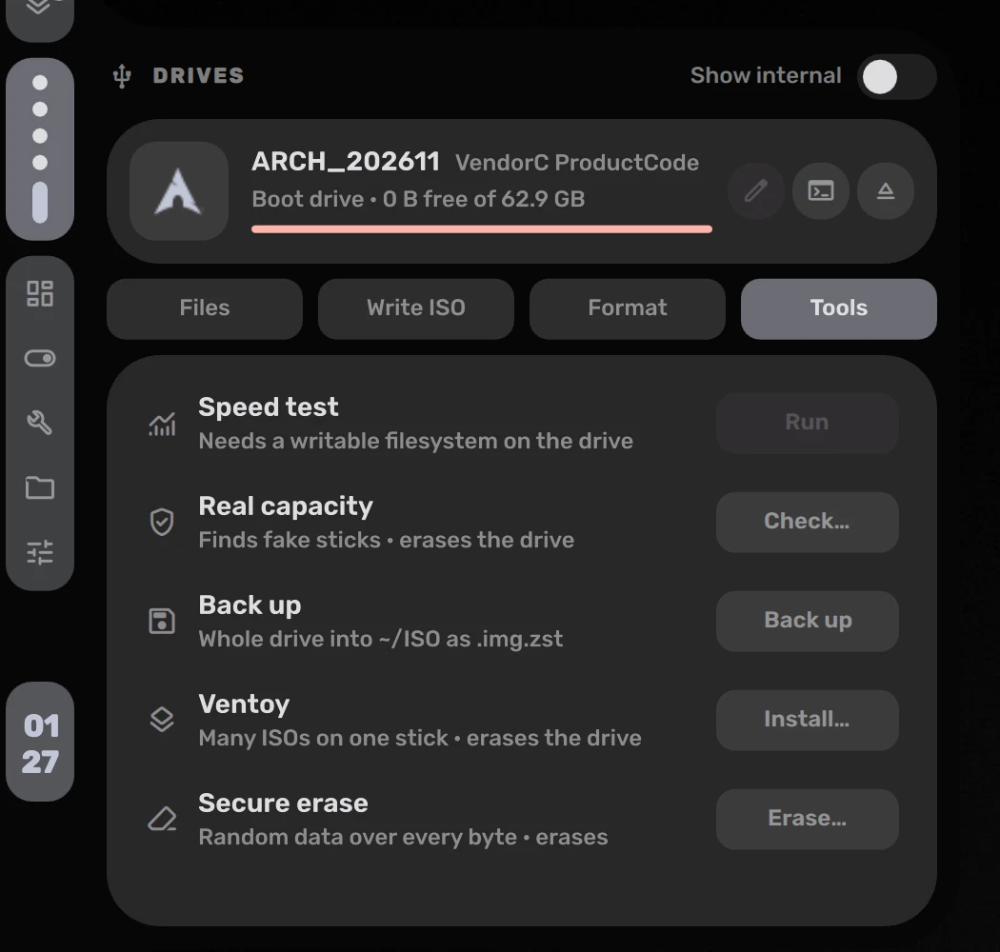
  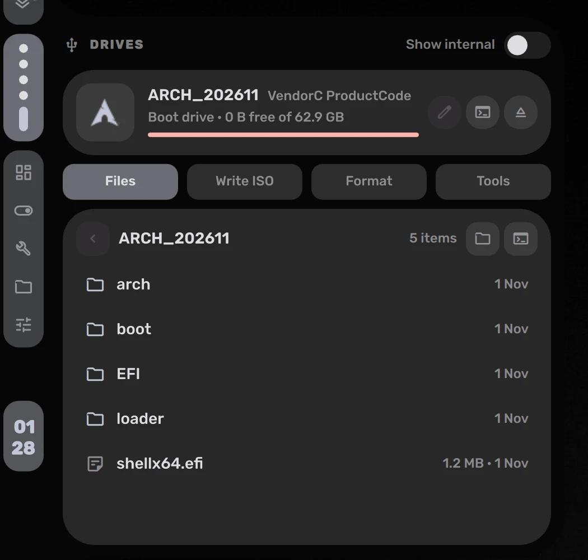
</p>
<p align="center">
  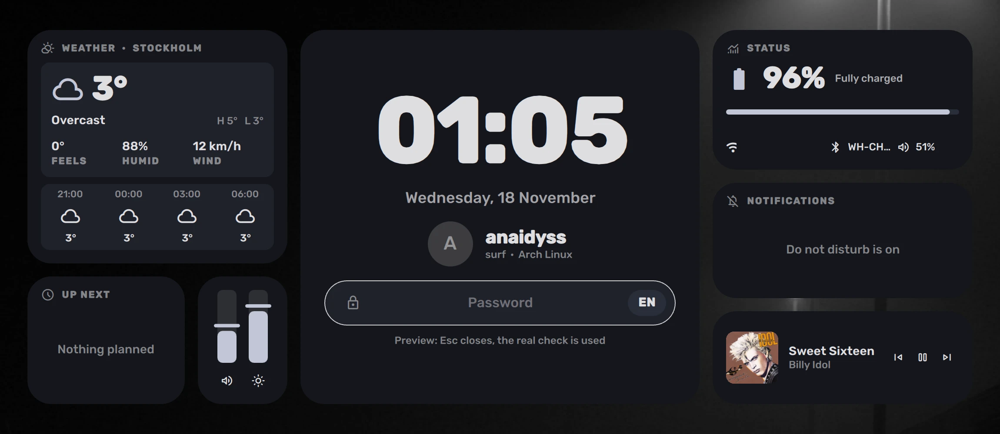
</p>
<p align="center">
  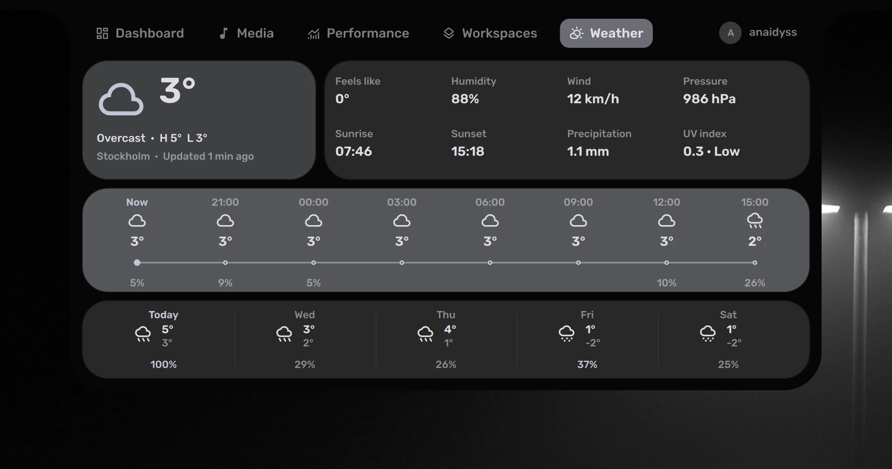
  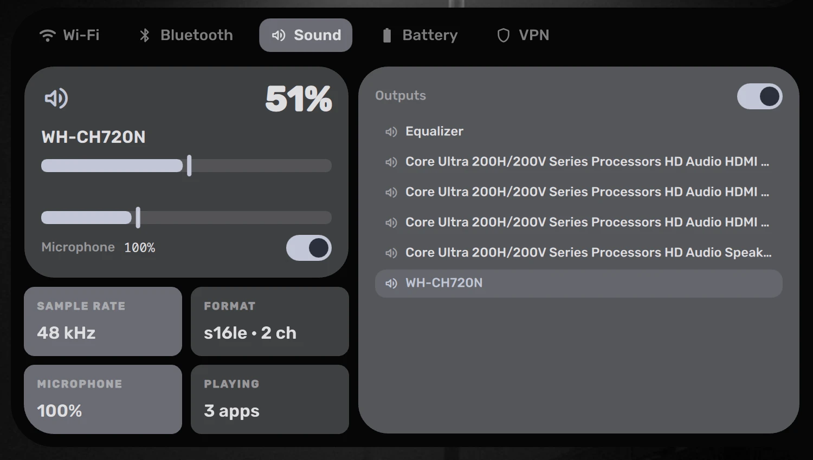
</p>
<p align="center">
  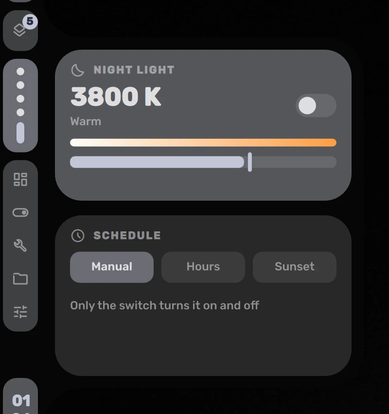
</p>

## install

arch (everything is in `extra`) or fedora (hyprland and friends from the `lionheartp/Hyprland` copr):

```sh
git clone https://github.com/anaidyss/hypr-shell ~/src/hypr-shell
cd ~/src/hypr-shell
./install.sh --dry-run    # see what it would do
./install.sh              # packages, dotfiles (stow), templates, system bits
./install.sh --check      # what is missing
```

`--no-optional` skips the nice-to-have packages, `--no-system` skips `/etc`, `--autostart` starts hyprland from tty1 if
you have no display manager. existing files are never overwritten, the script is safe to run again.

after the first login the shell picks a wallpaper and paints everything from it. drop your own pictures into
`~/.config/hypr-shell/wallpapers` or search for new ones in settings.

## keys

| key | does |
|---|---|
| `Super+Return` / `Super+T` | kitty / quick terminal |
| `Super+D` | launcher, calculator |
| `Super+V` | clipboard |
| `Super+grave` | dashboard |
| `Super+M` | keep menus open on all sides |
| `Super+comma` | settings |
| `Super+Shift+S` / `Super+Shift+D` | screenshot / screenshot editor |
| `Super+Ctrl+L` | lock |
| `Super+Ctrl+W` | next wallpaper |
| `Super+H/J/K/L` | focus, scrolling layout |

## layout

```
quickshell/   the shell: modules (panel, lock, osd, screenshot, settings…), services, components, theme
hypr/         hyprland config in lua: look, binds, rules, animations, all from the same tokens
bin/          hs-* helpers: wallpaper pipeline, app theming, drives, cursor, lock watchdog…
theme/        tokens (theme.json), templates for apps, fonts, icons (Veil), cursor sources
packages/     package lists for arch and fedora
```

## credits

[quickshell](https://quickshell.outfoxxed.me) · [hyprland](https://hyprland.org) · [matugen](https://github.com/InioX/matugen) ·
[Bibata cursors](https://github.com/ful1e5/Bibata_Cursor) (GPL-3.0) · [Simple Icons](https://simpleicons.org) (CC0) ·
[LRCLIB](https://lrclib.net) · design ideas from [serpantinum](https://github.com/ilyamiro/serpantinum) and caelestia,
reimplemented.

GPL-3.0.
